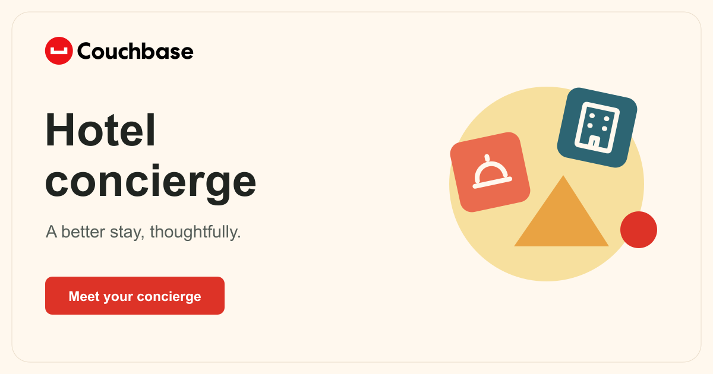

# Couchbase AI learning lab

Couchbase experiments, test reports, and the Hotel Concierge demo.

[Open Hotel Concierge](https://couchbase-hotel-concierge.vercel.app/) · [All demos](https://couchbase-demo-library.vercel.app/)

## Start here

- [Hotel Concierge](demos/harborline/README.md): try a guest request and review the checks, tools, and saved result.
- [AI Data Plane audit](FULL-AUDIT.md): findings and proposed improvements.
- [Marketing priorities](MARKETING-PRIORITIES.md): content and demo ideas.

## Explore the tests

- [NoSQL](nosql/README.md): documents, SQL++, indexes, and correctness.
- [Vector Search](vector-search/README.md): recall, filters, and quantization.
- [Lexical and hybrid search](lexical-search/README.md): text retrieval and input handling.
- [Agent operations](agent-operations/README.md): tools and tracing.
- [Memory status](MEMORY-STATUS.md): dependencies and recorded limitations.

## Setup and evidence

Each folder has its own instructions. Start with [Hotel developer notes](demos/harborline/OPERATIONS.md) for the hosted demo.

The [original audit overview](README-REFERENCE.md) preserves dated connection checks, evidence downloads, budget assumptions, and test limits. Those reports describe their test windows, not current cloud health or spending authority.

## Skills and feedback

- [Design and UI repair skills](https://github.com/jkupchanko/agent-skills)
- [Couchbase setup skill](https://github.com/john-couchbase/couchbase-aidp-setup)

For feedback, name the demo or report, describe what you tried, and include the result you expected. Keep credentials out of issues and screenshots.
