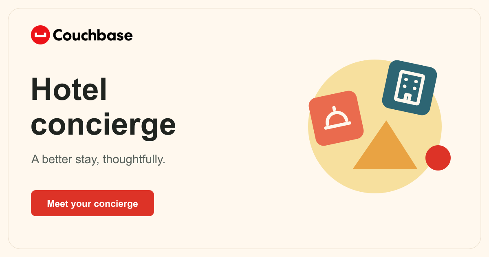

# Hotel Concierge

Ask for a room, an upgrade, or dinner plans. Follow the checks, tools, and decision beside the conversation.

[Open the demo](https://couchbase-hotel-concierge.vercel.app/) · [All demos](https://couchbase-demo-library.vercel.app/)

## Start here

- Type a request or choose a suggested option.
- Review the quote and confirm the demo booking.
- Open the receipt to review what was saved.
- Use Activity details and Saved activity to revisit the policy, tools, and results.

## What it uses

- Model Service selects policies and calls tools.
- Agent Catalog supplies policy and tool records; Agent Tracer records their execution.
- Capella stores sessions, receipts, history, and usage counters.
- Vercel hosts the interface and Python backend.
- Managed Agent Memory is not connected. Stored sessions are database records.
- Inventory and reservations are fictional. The shared limit is 100 model calls per day.

## Run locally

Use [Developer notes](OPERATIONS.md) for Python setup, configuration, and tests. Credentials stay on the server.

The [technical reference](README-REFERENCE.md#verification) records the last verification date and remaining live checks.

## Details and feedback

- [Technical reference and original documentation](README-REFERENCE.md)
- [Couchbase Design and UI Pattern Repair](https://github.com/john-couchbase/agent-skills)
- [Couchbase setup skill](https://github.com/john-couchbase/couchbase-aidp-setup)

When reporting an issue, include the request or input, what you expected, and a screenshot. Mention whether you used a phone, tablet, or computer.

### Decision evidence

Activity details separates the selected policy, tool calls, returned results, and trace records. The policy explanation is a short model-provided summary, not private reasoning. Tool inputs and outputs remain available on demand.

- **Policy:** selected instructions, content revision, and available alternatives.
- **Tools:** selected versus called, with each call ID and input.
- **Results:** guest response and the tool evidence supporting review.
- **Trace:** run ID and Agent Tracer records verified by readback. Failed or unavailable writes are shown explicitly.

Saved activity can reopen a request's decision trace. Static previews label their events as scripted and do not claim Agent Tracer persistence. Upgrade and dinner were verified against the live Oregon model, Agent Catalog, and Agent Tracer on November 12, 2026. All 14 decision/tool/response records passed trace readback, and booking changes persisted. Managed Agent Memory remains disconnected.

### Simulation and live mode

Use the top-right control to switch modes. Simulation is the default and uses browser-only sample decisions, bookings, and traces without model calls. Live data connects to the existing Couchbase backend and uses the shared daily model allowance. Both modes retain the same chat and decision-trace layout; simulated records are never represented as verified Agent Tracer writes. Switching reloads the view, and live bookings remain in their separate server session.

### Visual session trace

The Trace tab follows the same request, policy, call, result, and reply sequence in both modes. Records expand to show payloads and identifiers. The active handoff highlights as events arrive; reading or scrolling pauses automatic following. Upgrade and dinner sample scenarios share the backend policy names, revisions and tool sets. Sample values remain explicitly labeled and never claim remote persistence. See [the video comparison](docs/audits/2026-11-12-session-trace.md).

### Meaning match and Tools Hub

Click **Match** in Agent activity to inspect the guest request, the selected policy and its explanation, other available policies, and the tool set sent to the model. Live selection is model-based; this application does not return vector similarity scores. Simulation labels its match as scripted.

**Tools Hub** lists the 12 application functions, input contracts, associated policy revisions, and selected/called status for the current request. Search or filter to selected tools. Static definitions describe the application contract; loaded catalog descriptions appear when supplied by a live selection event. The hub does not claim to be a live Capella administration console.
